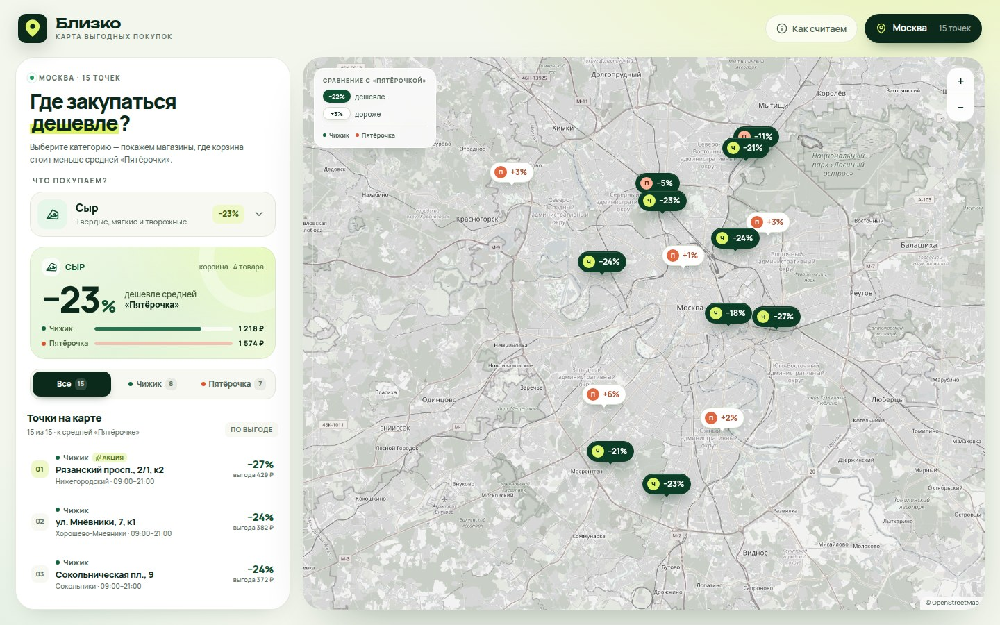

# Близко

Карта выгодных покупок в Москве. Выбираете категорию продуктов — карта показывает точки «Чижика» и «Пятёрочки», где корзина стоит дешевле средней цены «Пятёрочки».



## Что умеет

- 15 реальных адресов магазинов «Чижик» и «Пятёрочка» в разных округах Москвы.
- 10 категорий продуктов: сыр, молоко, хлеб, мясо, овощи и фрукты, бакалея, напитки, заморозка, сладости, бытовая химия.
- Для каждой категории собрана корзина из 4 товаров; экономия считается относительно средней корзины «Пятёрочки» с учётом локальных цен и акций.
- Метки на карте показывают процент экономии: тёмно-зелёные — дешевле, светлые — дороже.
- Рейтинг точек по выгоде, фильтр по сети, карточка магазина с ценами на каждый товар и ссылкой на маршрут.
- Кластеризация меток на мобильных, адаптивная вёрстка, клавиатурная навигация и доступные контролы.

## Стек

- Vue 3 + TypeScript, `<script setup>`
- Vite
- Leaflet + OpenStreetMap, `leaflet.markercluster` на узких экранах
- Manrope + Unbounded (Fontsource)
- Lucide-иконки

## Запуск

```bash
npm install
npm run dev
```

Сборка:

```bash
npm run build
npm run preview
```

## Как считается выгода

1. В каждой категории — четыре типовых товара с ценой для каждой сети.
2. Для каждой точки применяется детерминированная локальная вариация цены (±4%) и, иногда, скидка-акция 5–12% на категорию.
3. Опорная цена — средняя стоимость такой корзины в точках «Пятёрочки» (7 магазинов).
4. Экономия точки = `(опорная цена − цена точки) / опорная цена × 100%`.
5. Отрицательная экономия показывается как переплата (`+N%`). В рейтинге точки отсортированы по убыванию выгоды.

Цены, акции и проценты — **демонстрационные**. Адреса магазинов — реальные точки в Москве.

## Данные

Адреса и координаты собраны по открытым источникам: OpenStreetMap / Photon, 2ГИС, справочники магазинов Москвы. Список точек:

| Сеть | Адрес | Район |
| --- | --- | --- |
| Чижик | Профсоюзная ул., 152, к2 | Тёплый Стан |
| Чижик | Чертановская ул., 66, к3 | Чертаново Южное |
| Чижик | Волгоградский просп., 4А | Таганский |
| Чижик | Рязанский просп., 2/1, к2 | Нижегородский |
| Чижик | Сокольническая пл., 9 | Сокольники |
| Чижик | Ярославское ш., 30 | Ярославский |
| Чижик | ул. Яблочкова, 21Д | Бутырский |
| Чижик | ул. Мнёвники, 7, к1 | Хорошёво-Мнёвники |
| Пятёрочка | Халтуринская ул., 15 | Преображенское |
| Пятёрочка | Ярославское ш., 111 | Ярославский |
| Пятёрочка | Дмитровское ш., 43, к1 | Тимирязевский |
| Пятёрочка | Митинская ул., 17 | Митино |
| Пятёрочка | просп. Вернадского, 93 | Проспект Вернадского |
| Пятёрочка | Каширское ш., 42, к1 | Москворечье-Сабурово |
| Пятёрочка | Краснопролетарская ул., 16, с1 | Тверской |

## Структура

```
src/
  components/     интерфейс: панель, карта, карточка магазина, модалка
  composables/    анимация чисел
  data/           сети, категории, товары и реальные точки
  lib/            расчёт выгод, форматирование
  styles/         дизайн-токены и стили карты
  App.vue         состояние приложения
```

## Ограничения

- Нет бэкенда и авторизации — всё считается на клиенте из локальных данных.
- Тайлы карты загружаются с OpenStreetMap, поэтому нужен доступ в интернет.
- Проект не связан с ритейлерами; «Чижик» и «Пятёрочка» — товарные знаки соответствующих правообладателей (Магнит и X5 Group).
